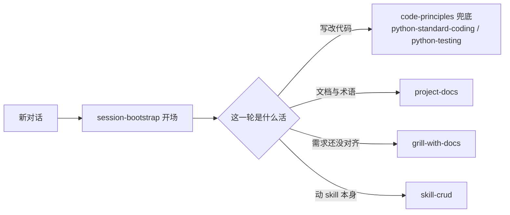

# Moye-Skills

一套个人向的 **Agent Skill** 库：把「怎么判断、怎么做」写成可复用的规范，一次编写，Cursor / dsh / Codex 三端共用。

Markdown 为主 · 无运行时依赖 · 目录联接共用一份正文 · 个人分享

## 页内目录

[介绍](#介绍) · [快速开始](#快速开始) · [怎么工作](#怎么工作) · [项目结构](#项目结构)

## 介绍

Agent Skill 是给 AI 读的规范：命中任务时它被读进上下文，替掉每次重讲一遍的口头约定。本仓把这些规范按作用域拆成 12 份，每份只管一层——会话怎么开场、代码怎么写、文档落在哪、需求怎么问清。

三端共用靠**目录联接**，不是拷贝：`setup.ps1` 把 Cursor / dsh / Codex 各自的个人 skills 目录指向本仓 `skills/`，所以只有一份正文，改一处三端同时生效。

| 能力（skill） | 做什么 | 不装会怎样 |
|---|---|---|
| `session-bootstrap` | 新对话开场七步：判当前 Agent、系统、skill 根目录、可用命令与 conda 环境，定这一轮的全局约束 | 每个会话都要重新交代工具与约定 |
| `code-principles` | 13 条跨语言代码判断，写改代码时兜底 | 没有兜底原则，AI 按各自默认口味写 |
| `python-standard-coding` | Python 写法与落盘：风格、类型、函数、容器、性能、脚本、多文件目录 | Python 风格与目录随对话漂 |
| `python-testing` | 先选定测试边界，再写进 spec，最后按一条用户路径写 pytest | 测试写了也不知道该测哪一层 |
| `project-docs` | 项目文档：术语表、ADR、人读 README、文档地图、最小视图 | 术语和决策没有落点，反复问同一件事 |
| `grill-with-docs` | 拷问式访谈：按轮次只问当前前沿能答的，边问边沉淀文档 | 需求没对齐就开写，返工 |
| `plain-todo` | 用白话把一项待办讲清再执行 | 待办含糊，动手后才发现没想清 |
| `playwright-cli` | 浏览器自动化：点击填表、页面快照、UI 走查、录屏/tracing、请求 mock、生成测试 | 界面验收只能靠人截图描述 |
| `skill-crud` | 个人 skill 的增删改查（建 / 改 / 删 / 找）与 skill 文本规范 | 改 skill 容易破坏单一事实源、漏改连带文件 |
| `skill-analyse` | 把上游或本地的 skill 拆成 analyse 分析报告 | 想收编别人的 skill 时得自己啃源码 |
| `session-tools` | 本轮会话自检、写交接文档、抽可迁移面试题 | 长会话丢了上下文，只能从头重讲 |
| `self-notes-read` | 查阅、整理、书写 Markdown 知识库（要配 `NOTES_ROOT`） | 笔记不按统一框架进库，沉淀不下来 |

`backup/` 里放着两份已退役、待重构的 skill（前端页面、Windows 桌面壳界面），不被三端扫描。

## 快速开始

### Ⅰ 装上并跑通（必需，约 5 分钟）

```powershell
git clone git@github.com:moyezq/Moye-Skills.git
cd Moye-Skills
copy .env.example .env
powershell -ExecutionPolicy Bypass -File .\setup.ps1
```

`.env`（模板 [.env.example](.env.example)）里只需确认三个产品目录：模板给的是 `%USERPROFILE%` 下的默认位置，没装的产品留空。看到 `ok <产品目录> -> <本仓>\skills` 就是接上了，然后**重启 Cursor / dsh**——目录联接只在启动时读一次。

验收：新开一个对话，问「这段代码还能怎么简化」。`code-principles` 应当被读到，并按那 13 条回答。

### Ⅱ 配齐完整能力（可选）

`.env` 里这四组键按需填，都不影响 Ⅰ 能不能跑通：

| 键 | 配了能做什么 | 没配会怎样 |
|---|---|---|
| `GITHUB_PAT` | dsh 会话里自行 fetch / pull / push 本仓 | 远端 git 操作交你自己的终端，其余不受影响 |
| `NOTES_ROOT` | `self-notes-read` 能读写你的 Markdown 笔记库 | 这份 skill 拿不到库路径，其它 skill 不受影响 |
| `NPM_CACHE` | npx 缓存落在你指定的目录，受限沙箱里也能写 | 回落到 `WORKSPACE_ROOT` 下的 `.npm-cache` |
| `MOYE_SKILLS_ROOT` / `WORKSPACE_ROOT` | 需要绝对路径的 skill 有据可查 | 只少一条路径来源，不报错 |

`GITHUB_PAT` 要 fine-grained、只给 `Contents: Read and write` 权限。

### Ⅲ 试一次（三条真实触发）

1. 新开会话，第一句话说任意内容 —— `session-bootstrap` 先做开场，报出当前 Agent、系统与工作目录。
2. 说「先问清楚再动手」—— `grill-with-docs` 按轮次提问，每轮只问当前前沿能答的。
3. 说「用浏览器把这一步点一遍」—— `playwright-cli` 驱动浏览器并留下快照。

触发全靠各 skill 的 `description`：命中就读，没命中就直接点它的名字。

## 怎么工作



- **一份正文，三端共用**：产物只有 `skills/` 一棵树，三端目录都是它的联接。
- **触发靠 description，材料靠指针**：`description` 常驻在对话目录里，命中才读正文；正文只留每条路径都要的步骤，细则推到 `references/` 按需读。
- **开场只有一份**：`session-bootstrap` 决定这一轮按哪套工具干活，其余 skill 不在开场预加载。
- **叫法与决策有落点**：规范名称进 `CONTEXT.md`，仍有效的为什么进 `docs/adr.md`，废掉的追加 `docs/HISTORY.md`。

## 项目结构

```text
Moye-Skills/
├── README.md          # 你正在读的这份
├── setup.ps1          # 把三端个人 skills 目录联接到本仓 skills/
├── .env.example       # 本机配置模板，复制成 .env 再填
├── skills/            # 工作树：12 份 skill 的正文，三端共用
├── skills-list.md     # 薄索引：一行一个 skill
├── CONTEXT.md         # 术语表：本系统特有叫法的规范名称
├── backup/            # 已退役待重构的 skill，不被扫描
├── docs/              # 内部说明，日常使用不必读
└── preinstall/        # 上游 skill 取源暂存区，等人审
```

远程仓库：`git@github.com:moyezq/Moye-Skills.git`（`origin` 用 SSH）。

`.env`、`preinstall/`、`*-workspace/`、`.idea/` 都在 `.gitignore` 里，不进仓。
