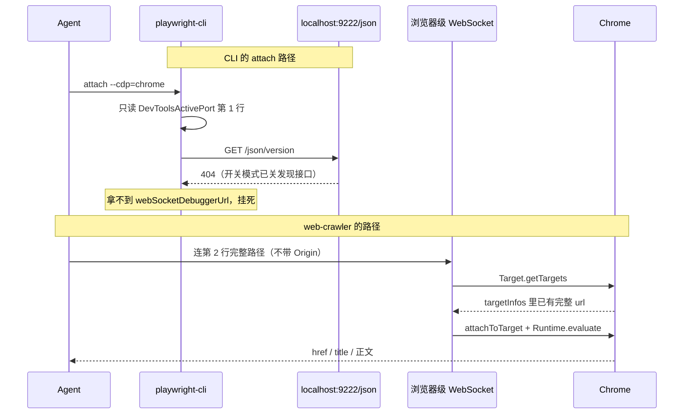

# web-crawler 调研报告

> 来源：本仓 `skills/web-crawler`（无公开上游；由 `preinstall/` 迁入）

这份报告说明：这个 skill 要解决什么问题、现在做成了什么样、**playwright-cli 与原生 CDP 两套栈各自在干什么、为什么前者接不住日常 Chrome**、两边 harness 实机怎么跑、Chrome 远程调试在新版本里实际允许什么。给人读，不是给 agent 当运行时规范。agent 只读 `skills/web-crawler/SKILL.md` 和它指向的 `references/`。

---

## 1. 问题从哪来

要抓一个必须看见真实页面的站时，agent 常做两件错事：

1. 用空白浏览器反复打开，把登录墙再撞一遍。
2. 把「我这边某个浏览器已经登录」说成「这个站不用登录」，或把 harness 内置浏览器里的 Cookie 当成用户日常 Chrome 里的登录态。

练习站（无登录、HTML 里就有字段）套得上「GET 再解析」。小红书这类站套不上：同一站点不同路径，匿名可能进、也可能跳登录；登录后的推荐流和匿名 SSR 不是同一份数据。

所以 skill 先做选路：**匿名状态**和**会话状态**分开记，取页手法按窗口拆成能力。目前落地的能力只有一项：接到用户本机 Chrome / Edge，列出标签并取出当前页。

---

## 2. skill 现在长什么样

落点：`skills/web-crawler/`。开场不会自动加载，description 命中再读。

```text
web-crawler/
├── SKILL.md                      选路：两份状态、三种窗口、何时读细则
├── references/chrome-tabs.md     能力：用户 Chrome 列标签并取当前页
└── scripts/chrome-tabs.mjs       一条 WebSocket 跑完握手→列标签→取页
```

**SKILL.md** 不管具体怎么连 Chrome。它只要求：先对用户点名的那个 URL 做一次到达 HTTP 层的 GET；再分别列出 harness 标签、CLI 会话、用户 Chrome；要登录时不要空白新开；用户至多点一次授权，之后整场任务只握一条调试连接。

**chrome-tabs.md** 才是「Agent 操作用户 Chrome 获取标签页」的规范：可读 `DevToolsActivePort` 第二行、握手不要带 Origin、`Target.getTargets` 只要 `type=page`、一条连接做完、不要 `Browser.close`。

三种窗口的登录态不属于同一份 Cookie：

| 窗口 | 登录态属于谁 | 典型接入 |
|------|----------------|----------|
| 匿名 HTTP | 没有浏览器 Cookie | `curl` / `urllib` 跟随跳转 |
| harness 自带浏览器 | 该产品自己的 Cookie 罐 | Cursor 的 Browser Tab；与系统 Chrome 隔离 |
| 用户本机 Chrome / Edge | 用户正在用的配置 | Chrome 136+ 开关模式 + 一条 CDP WebSocket |

---

## 3. 两套栈各自在干什么

「接管浏览器」说的不是「往 9222 端口发点东西」。它要求三件事同时成立：找到**正在跑的那一个** Chrome、连上它对外真正暴露的调试口、在**已有标签**里读到 URL 和正文。playwright-cli 和 web-crawler 在这三步上走的不是同一层协议。

### 3.1 playwright-cli：测试驱动器，默认自己开浏览器

它是 Playwright 的命令行外壳，给 agent 做**自动化测试**：自己起一个 Chromium、点、填、拍无障碍树快照、录 tracing、生成测试。默认路径：

```text
playwright-cli open
  → 拉起 Playwright 自己的 Chromium（独立 user-data-dir，Cookie 是空的）
  → 后台守护进程握住 Browser / Context / Page
  → 之后每条 click / snapshot / eval 都打这个守护进程
```

这条路上它很稳，因为浏览器是它生的、Page 对象是它初始化的、每个标签的 `page.url()` 都有值。`open --persistent` 也只是把**它自己的**配置落到磁盘，不是接到用户日常那个 Profile。

`attach --cdp=chrome` 是侧门：不去新开，去连已经在跑的 Chrome。0.1.18 的实现是：

```text
读 DevToolsActivePort，只取第 1 行端口
→ 拼成 http://localhost:<端口>
→ Playwright connectOverCDP 去 GET /json/version
→ 从 JSON 里拿 webSocketDebuggerUrl，再升级 WebSocket
→ 把每个 target 包成 Playwright Page，等 frame 初始化
→ tab-list / snapshot / eval 都等 page.url()
```

这套发现方式对应的是旧开关：Chrome 用 `--remote-debugging-port` 启动时，会同时开 HTTP 发现接口（`/json/version`、`/json/list`）和浏览器级 WebSocket。Playwright 从第一天就按这个契约写 `connectOverCDP`。

Chrome 136 起，**默认用户数据目录**上 `--remote-debugging-port` 失效。日常那个已登录的 Chrome 只能勾 `chrome://inspect/#remote-debugging`。这个模式只写 `DevToolsActivePort` 两行、只留浏览器级 WS，**关掉了整套 `/json/*`**。CLI 的发现步骤在这里没有输入。

即便绕过发现、把第二行的 `ws://…/devtools/browser/<uuid>` 直接喂给 `attach`，会话能建起来，下一步仍会挂：Playwright 必须把 target 做成 Page。对小红书这类页，target 对得上，但 `page.url()` 恒为空串；`tab-list` 要等每一个 Page 的 URL，于是空等。对照页 `quotes.toscrape.com` 的 `pageUrl` 正常，所以不是「开着 DevTools 就会坏」，是 **Playwright 的 Page/Frame 初始化在这个 target 上没完成**。原生 CDP 不走这一层，同一页立刻能 `evaluate`。

还有一层进程模型：CLI 一条命令常常是一个子进程。开关模式按**每条进来的 WebSocket**弹 Allow。任务里 `attach` 一次、`tab-list` 一次、`eval` 一次，等于让用户点三次，或让后两次在授权墙前静默挂死。

所以「CLI 做不到接管」不是 CDP 本身不能用，是三处契约叠在一起断了：

| 断点 | CLI 假定 | 日常 Chrome 开关模式实际给的 |
|------|----------|------------------------------|
| 发现 | HTTP `GET /json/version` 返回 `webSocketDebuggerUrl` | `/json/*` 全 404；端点只在 `DevToolsActivePort` 第二行 |
| 页面 | 每个 target 都能变成 Playwright Page，`page.url()` 有值 | 部分反爬页 attach 得上，Frame 不初始化，`page.url()` 空串 |
| 连接 | 每条 CLI 命令可以再握一次调试口 | 新 WS = 可能再弹 Allow；半开连接会把端点卡住 |

它适合自己 `open` 就能做完的测试，不适合去接已经在跑的浏览器。

### 3.2 web-crawler：不经过 Playwright，直接说 CDP

落地脚本是 `scripts/chrome-tabs.mjs`。它不启浏览器、不建 Page、不拍快照，只做「一条 WebSocket 上的五步」：

```text
读 DevToolsActivePort 两行
→ ws://127.0.0.1:<端口><第 2 行路径>（握手不带 Origin）
→ Target.getTargets          ← URL 直接来自 Chrome，不经过 page.url()
→ Target.attachToTarget { flatten: true } → sessionId
→ Runtime.evaluate（带 sessionId）取 href / title / 正文
→ detach 或断开进程；不发 Browser.close
```

这五步对应的是开关模式真正留下的那一个口：浏览器级 WebSocket。`Target.getTargets` 里的 `url` 是 Chrome 自己报的，所以小红书那个 target 在 CLI 里 `pageUrl=""`，在这里是完整的 `https://www.xiaohongshu.com/explore?…`。`Runtime.evaluate` 跑在该 target 的 session 上，不要求 Playwright 的 frame 树就绪。

整场任务只建这一条连接：列标签和取页复用同一个 socket，用户至多点一次 Allow。取完断开，用户的 Chrome 继续跑。

它不管自动化测试：不点、不滚、不代填登录、不 `Browser.close`。管到当前页数据在手为止。



### 3.3 你以为 / 实际

| 你以为 | 实际 |
|--------|------|
| 端口 9222 在听 = 可以 attach | 端口在听只说明有人绑了 9222。开关模式不提供 `/json/version`，只提供第二行那条 WS |
| `attach --cdp=chrome` 就是「接管已有 Chrome」 | 0.1.18 把它翻译成「对 localhost:端口做 HTTP 发现」。发现接口关了，命令不会失败退出，会一直等 |
| 连上了就能 `tab-list` | Playwright 还要 Page/Frame。target 在、`page.url()` 空，列表命令会再挂一次 |
| 换 CLI 的 `open --persistent` 也能用登录态 | 那是 Playwright 自己的配置目录，不是用户日常 Profile |
| Cursor 内置浏览器很快 = 它更会连 Chrome | 内置标签根本没走 CDP；Cookie 罐和工作区绑定，和系统 Chrome 隔离 |
| 两种工具都是「浏览器自动化」，可以互相替代 | CLI 拥有并驱动一个测试用浏览器；web-crawler 旁路进用户已经打开的那一页。目标不同 |

实测数字、对照页、授权弹窗见 §5。Chrome 136 之后官方还允许什么，见 §7。

---

## 4. 核心判断（两边实机都成立）

### 4.1 两份状态

| 状态 | 问的是 | 最短取法 |
|------|--------|----------|
| 匿名状态 | 空身份打这个 URL，进不进得了业务页 | 一次跟随跳转的 GET |
| 会话状态 | 眼前这个已开窗口是登录墙还是业务页 | 列已有会话，对目标站那一页取一帧 |

匿名 GET 已经跳到 `/login?redirect=…`，就不要再开空白浏览器去「确认」。harness 里已经登录，也不能宣布「这个站不用登录」。

同一站点不同路径要各自 GET。DSH 测过：`/explore` 匿名可进，`/notification` 匿名被重定向到登录页。

匿名次数按「到达 HTTP 层」计：TLS 握手失败不算一次，也不改写结论。

### 4.2 选路

| 匿名 | 会话 | 做 |
|------|------|-----|
| 可进 | 任意 | HTTP 够就用 HTTP |
| 要登录 | 某窗口已有业务数据 | 接入那一个窗口 |
| 要登录 | 没有可用会话 | 请用户做一次接入准备（打开已登录页、打开远程调试、点一次 Allow） |

用户接受登录或点授权，但必须是**任务级一次性**，不能每一步重新握手。Chrome 开关模式按「每条进来的 WebSocket」弹 Allow，所以实现上必须整场任务只建一条连接。

---

## 5. DSH 实机（2026-10-13 至 10-14）

执行者：DSH + 子 agent。浏览器：Chrome 154.0.8037.99，命令行仅 `--profile-directory="Profile 2"`，**没有** `--remote-debugging-port`。远程调试靠 `chrome://inspect/#remote-debugging` 勾选 Allow remote debugging。`DevToolsActivePort` 第 1 行 `9222`，第 2 行 `/devtools/browser/<uuid>`。playwright-cli 全局 0.1.18。

产物根目录：`E:\Project\skill-test\web-crawler\`。

### 5.1 判断层：过关

**B 组**公开站 `https://quotes.toscrape.com/`：匿名可进（200、URL 不跳、正文 10 条语录）。到达 HTTP 层的 GET 1 次（另一次 TLS 失败未计入）。开浏览器 0 次。

**A 组** `https://www.xiaohongshu.com`（实际落到 `/explore`）：匿名可进，正文约 191KB，页内 `loggedIn=false`，SSR 推荐流 31 条。到达 HTTP 层 GET 1 次（0.96s）。开浏览器 0 次。

结论：两份状态和「先 GET」成立，而且性价比最高。

### 5.2 接入层：旧工具链失效（第一轮）

原理对照见 §3。这里只记本机数字。

skill 初版把「本机可接入的 Chrome」和 `playwright-cli attach` 写在一起。在开关模式下：

**端口在听 ≠ 可接入。** 对 9222 发 HTTP：

| 请求 | 响应 |
|------|------|
| `GET /json/version`、`/json/list`、`/`、`/devtools/browser/` | 404，空 body |
| WebSocket 升级，带 `Origin: devtools://devtools` 等 | 403，提示要用 `--remote-allow-origins` |
| WebSocket 升级，不带 Origin、路径又不对 | 无响应，25s 仍不回 |
| WebSocket 连到 `DevToolsActivePort` **第二行**的完整路径 | 成功（约 3–10s） |

A 组按业界惯例「探端口 + `/json/version`」，两次 404 后写「9222 不是 CDP 端点」并放弃接管。结论错了，错在判据。

**`playwright-cli attach --cdp=chrome` 必然挂死。** 0.1.18 读 `DevToolsActivePort` 只取第 1 行端口，拼成 `http://localhost:9222`，再去请求已关闭的 `/json/version`，拿不到 `webSocketDebuggerUrl` 也不退出。实测 75 秒零输出。

**即使用完整 WS 地址 attach 成功，`tab-list` 仍会挂。** Playwright 能对应到小红书那个 target，但该 page 的 `page.url()` 恒为空串，`tab-list` 要等每个 page 的 URL，于是再空等 60 秒。对照标签 `quotes.toscrape.com` 的 `pageUrl` 正常，所以不是「开着 DevTools 就会坏」。

**开关模式要人在场。** 同一端点，有时 2.9s / 9.9s 连上，有时 25s / 90s 完全静默。Chrome 按连接弹 Allow；用户点过之后窗口开一阵，之后又回到等授权。杀掉半开连接会把端点卡住一段时间。

### 5.3 已验证可用的 5 步（不经 playwright-cli）

1. 读 `DevToolsActivePort` 两行。
2. 连 `ws://127.0.0.1:<端口><WS路径>`（不要带 Origin）。
3. `Target.getTargets`，找 URL 含目标站的 `page`。
4. `Target.attachToTarget { targetId, flatten: true }` → `sessionId`。
5. 带 `sessionId` 的 `Runtime.evaluate` 取 href / title / 正文。收尾 `detach` 或断开进程，**不发 `Browser.close`**。

主会话用这 5 步拿到用户 Chrome 里已打开的 `/explore?channel_id=homefeed_recommend`：`readyState=complete`，正文是登录态推荐流（`bodyLen=892`），和 A 组匿名 SSR 的 31 条**不是同一份东西**。这说明「接管已有浏览器」确实有独立价值。

### 5.4 复验（2026-10-14，skill 已按上列事实改过）

靶子改为必须登录的 `https://www.xiaohongshu.com/notification`（测试方已在用户 Chrome 中打开该页）。主 agent 与子 agent 各跑一次。

| 项 | 主 agent | 子 agent |
|----|----------|----------|
| 匿名 GET | 408ms，落到 `/login?redirectPath=…` → 要登录 | 615ms，同一结论 |
| CLI 会话 | 无 | 无 |
| 用户 Chrome 握手 | 1324ms | 2400ms |
| 列标签 | `Target.getTargets` | 同 |
| 取数 | 标题「通知 - 小红书」，正文 885 字，含真实通知 | 同页同数据 |
| 调试连接 | 1 条 | 1 条 |
| 失败 / 超时 | 0 | 0 |

两条线都没有再用 `attach --cdp=chrome`、CLI `tab-list`、`Browser.close`。

需要更正的误判：子 agent 曾写「未弹 Allow，所以不是开关模式」。核实命令行仍无 `--remote-debugging-port`，`/json/version` 仍 404。未弹窗只是**当前授权还有效**。跨任务会不会再弹，取决于 Chrome 侧有效期，本报告不下结论。agent 仍按「每条新连接都可能要点一次」来实现：任务内不重连。

### 5.5 解析页面状态时踩过、但不属于选路的坑

- `window.__INITIAL_STATE__` 里有 JS 的 `undefined`，直接 `JSON.parse` 会失败；先换成 `null`。
- PowerShell `ConvertFrom-Json` 会因 `nickName` / `nickname` 这种大小写冲突报错。

这两条写进了 `chrome-tabs.md` 的「取当前页」，不进选路正文。

---

## 6. Cursor 实机（2026-10-13）

执行者：Cursor 对话里的 Agent，工具是 Cursor 自带浏览器（`cursor-ide-browser`），不是用户的 Chrome Profile 2。

### 6.1 匿名 GET

对 `https://www.xiaohongshu.com/explore` 用 Python `urllib` 跟随跳转：

- 状态码 200
- **最终 URL** 变成 `https://www.xiaohongshu.com/login?redirectPath=…explore…`
- 正文约 36KB，有 `__INITIAL_STATE__`，没有笔记标题、没有 `noteDetailMap`

按后来的选路规则：这一次已经把匿名状态定为「要登录」，不应再开空白浏览器去撞。

同一 URL，DSH 的匿名 GET 却停在 `/explore` 并解析出 31 条 SSR。两边都是事实：匿名结论必须按**这一次、这一个客户端、这一个 URL** 记，不能跨会话复用「小红书不用登录」。

### 6.2 随后打开的是 Cursor 内置浏览器

当时标签列表是空的，Agent 导航到 `/explore`。快照里同时有手机号登录框和三十来条笔记标题。页面脚本里 `user.loggedIn === true`，`feed.feeds` 约 34 条，`noteCard.displayTitle` 等字段齐全。`__INITIAL_STATE__` 就在文档的 script 里。

全程没有读 `DevToolsActivePort`，没有 `playwright-cli attach`，也没有让用户点 Allow。IDE 对内置浏览器本来就有协议口。

### 6.3 「碰巧已登录」不是克隆了系统 Chrome

Cursor 官方说明：内置 Browser Tab 的 Cookie / localStorage 按**工作区**持久化，和系统 Chrome 隔离。Chrome 里登过的站，内置标签里可以仍是未登录。

当时 `loggedIn: true`，只说明**这个工作区的 Cursor 浏览器自己的罐里已经有小红书会话**（用户或更早的 Agent 在这个内置页里留过登录）。Agent 没有、也无法用系统 Chrome 的用户配置去「模拟」登录。

所以 Cursor 这边「很快拿到选项卡和内容」，和 DSH 要用户点 CDP，比的不是谁更会连 Chrome，而是**接的根本不是同一个浏览器**。

### 6.4 对 skill 的含义

若把 harness 自带标签和用户 Chrome 写在同一列「本机有浏览器」，Cursor 会在内置页上取到一份登录态，DSH 会去撞用户 Chrome 的授权墙，两边都以为自己在走「通用接管」。正文必须把三种窗口拆开；接到用户 Chrome 时只走 `chrome-tabs` 这一份能力细则。

---

## 7. Chrome 136 之后远程调试实际允许什么

从 Chrome 136 起，对**默认用户数据目录**，`--remote-debugging-port` 不再生效，必须配非默认 `--user-data-dir`。日常那个已登录的 Chrome，只能用 `chrome://inspect/#remote-debugging` 打开「允许远程调试」：

- 只暴露浏览器级 WebSocket，`/json/*` 发现接口关掉。
- 每条进来的连接要用户点 Allow（approval mode）。
- 点一次之后，**同一条连接上**可以 `getTargets`、`attach`、多次 `evaluate`，不必逐步再授权。
- 断开再连 = 可能再弹一次，或静默等待。

因此「任务里登录或点一次授权」做得到；「每个步骤都申请」是实现把一条任务拆成了 N 条连接（每次 `playwright-cli` 子进程、每次探测脚本退出、中途 `job_kill`）。

无人值守、完全不弹窗：只能用独立目录加上 `--remote-debugging-port` 启动专用 Chrome，不要去接管日常 Profile。Playwright 扩展接入（`attach --extension`）官方说能复用已登录标签，本调研**未测**。

---

## 8. 建议如何写进了 skill

DSH 第一轮提出六条修改建议。2026-10-14 复验时按「已采纳」结案。当前正文对应关系：

| 建议 | 写在哪 |
|------|--------|
| 匿名次数按到达 HTTP 层计；同站不同 URL 各自判定 | SKILL.md §1 |
| 可接入 = `DevToolsActivePort` 两行 + WS 握手成功；`/json/*` 404 不是否决 | chrome-tabs.md「可接入」 |
| 接入/列标签 60 秒上限，超时当「不可用」，不重试；禁用 `attach --cdp=chrome` 做发现 | SKILL.md §2；chrome-tabs.md 最短路径 |
| `page.url()` 空串时改走 `getTargets` + `evaluate` | chrome-tabs.md「列标签」「取当前页」 |
| 用户可点一次 Allow；任务内一条连接；未弹窗 ≠ 非开关模式 | SKILL.md §3；chrome-tabs.md「可接入」 |
| 用户 Chrome 不走 playwright-cli 的 `attach --cdp=chrome` | SKILL.md 邻域入口；能力表指向 chrome-tabs.md |

已知断点（0.1.18 丢掉 WS 路径、`tab-list` 死等空 `page.url()`）写在 chrome-tabs 的对错对照里，不把调研报告路径写进 skill（那会变成第二份运行时规范）。

---

## 9. 仍未验证

1. 升级 `playwright-cli` 到 0.1.22 是否修掉「只读端口、打 `/json/version`」这条断点。
2. Playwright 扩展接入（`attach --extension`）。
3. 关掉挂在目标标签上的 DevTools 窗口后，Playwright 的 `page.url()` 会不会恢复（对照实验倾向于不会，未关窗重测）。
4. 发现页、关注流、公开主页上「匿名 SSR」和「登录后页面」差多少字段（已知不是同一份，未做字段级对照）。
5. 跨任务、隔一段时间后，开关模式是否还要再点 Allow（只确认：授权会持续一段时间；有效期未知）。
6. Cursor 内置浏览器与用户 Chrome 同时打开同一站时，选路是否会被 agent 再次混用（规范已写，未做对抗测试）。

---

## 10. 复现材料

| 材料 | 路径 |
|------|------|
| B 组对照（公开站） | `E:\Project\skill-test\web-crawler\B-control\` |
| A 组匿名 SSR（发现页） | `E:\Project\skill-test\web-crawler\A-xiaohongshu\` |
| 主会话协议探测（第一轮） | `E:\Project\skill-test\web-crawler\_dsh-probe\` |
| 复验（通知页接管） | `E:\Project\skill-test\web-crawler\M-sub\` |
| 早期精简笔记 | `_dsh-probe/FINDINGS.md` |

`_dsh-probe/` 含完整 WS 端点和页面正文，给子 agent 跑对照时曾临时挪出工作区，避免「答案泄漏」。它们不是 skill 的运行时依赖。运行时脚本是 `skills/web-crawler/scripts/chrome-tabs.mjs`。

---

## 11. 一句话

判断层（先 GET、两份状态、三种窗口）两边都成立。playwright-cli 是测试驱动器：自己开浏览器、用 HTTP `/json/version` 发现、用 Playwright Page 读 URL；日常 Chrome 的开关模式把这三步全拆了，所以接管挂死。接到用户已登录的 Chrome，在 136 之后只有一条稳的路：人打开远程调试并点一次 Allow，agent 用 `DevToolsActivePort` 第二行握一条 WebSocket，原生 CDP 列标签、取当前页。Cursor 内置浏览器快，是因为它根本没走这条路。
