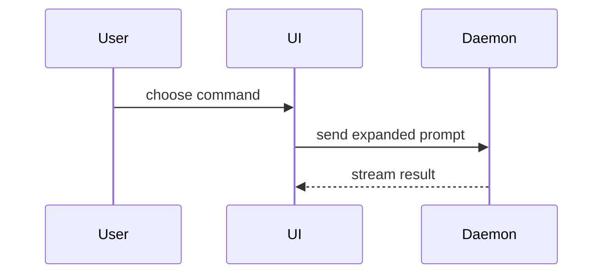

# 最小视图选型

何时落盘、文件名见主文件「最小视图」。本文只管选哪种视图、怎么呈现。

用视觉把当前话题讲明白。跳过开场套话，正文短。选**能说清关键点的最小视图**。

## 视图选型

按问题选一种或几种，**不要全用**，别堆满。

### 逻辑 / 算法 → 伪代码

```text
on(save)
  if content is unchanged
    return cached result
  write new content
  return fresh result
```

### 运行时控制流 → 调用树

```text
submitForm
  createSession
    persistPrompt
    launchAgent
  navigateToSession
```

### UI 结构 → 组件树

带上有关的 state 与模块边界：

```tsx
<SessionPage> (apps/example/src/routes/session.tsx)
  useSessionEvents()
  <SessionToolbar>
    <RunSkillButton> (packages/ui)
```

### 文件职责 / 大重构 → 浅层文件树

```text
src/
├── commands/       # 解析用户动作
├── sessions/       # 拥有 session 状态
└── transport/      # 发 API 请求
```

### 组件交互 / 控制流 / 数据流 → Mermaid



### 重点是「改了什么」→ diff

周围架构形态已存在时用 `diff`；diff 形态要贴合话题。

组件改动：

```diff
 <SessionPage>
   useSessionEvents()
   <SessionToolbar>
+    <RunSkillButton />
   <SessionTimeline>
+    <SkillResultCard />
```

目录布局改动：

```diff
 src/
 ├── commands/
+│   └── expand.ts
 ├── sessions/
-└── transport.ts
+└── transport/
   ├── client.ts
   └── stream.ts
```

调用树 / 调用栈改动：

```diff
 submitForm
   createSession
     persistPrompt
+    expandSkillMention
     launchAgent
-  navigateToSession
+  navigateToSession
+    subscribeToEvents
```

状态或控制流改动：

```diff
   on(save)
-  write content
+  if content is unchanged
+    return cached result
+  write new content
+  invalidate cache
```

### 整块都是新的架构形态 → 完整代码块

大半是新内容、省略会藏掉所有权/顺序、或用户需要可复制的目标架构形态时，给整块：

```ts
function expandSkill(command: string): string {
  const skillName = command.slice(1)
  return `use the ${skillName} skill`
}
```

### 复杂界面 / 布局 / 状态对比 / Mermaid 放不下 → 单页说明 HTML

写**一个**单页说明 HTML（示意图、信息图、或短幻灯，择一贴合要点）。对齐产品配色、字体、间距与组件；用真实标签与数据；兼顾桌面与移动。

路径由主文件落盘规则决定。写完后打开该路径（Windows）：

```powershell
Invoke-Item "<已写入的 html 路径>"
```

`.md` 不打开。

## 呈现纪律

* 每个视觉紧挨它支撑的那段短文字。
* 只保留回答当前问题（或解当前分歧的选项）所需的调用、文件、props、state、边界。
* 可用一种，可用几种，几乎不会全用。自行判断，别淹没用户。
